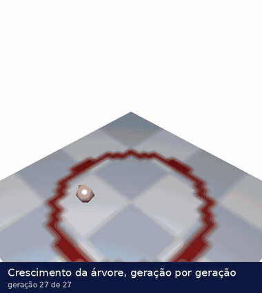

# Árvores arteriais CCO em 3D

<p align="center">
  
</p>

Visualizador 3D de **árvores arteriais sintéticas**, redes de vasos sanguíneos geradas por computador pelo método CCO (*Constrained Constructive Optimization*). Cada vaso é desenhado como um tubo com a espessura do seu raio real; o sangue pulsa da raiz até as pontas, e um clique num vaso mostra de onde vem o sangue dele e tudo o que ele irriga.

Feito em Python com OpenGL, com shaders, câmera, Ray Casting e um mini Ray Tracer escritos do zero. Vídeo em melhor qualidade: [`demo/demo.mp4`](demo/demo.mp4).

**BCC327 – Computação Gráfica · UFOP · 2026.2** · Prof. Dr. Rafael Alves Bonfim de Queiroz

> Branch `portfolio`: evolução do TP2 para portfólio. O TP1 está na branch `main` e o TP2, como entregue, na branch `tp2`.

## Integrantes

| Nome | Matrícula |
|---|---|
| Brenda Gabrielle Alves Nascimento | 24.1.4011 |

## Visão geral

O TP2 evolui o visualizador do TP1 para uma aplicação de visualização científica 3D:

- **Visualizador CCO** (`src/visualizador.py`): tubos 3D com espessura proporcional ao raio, câmera e vistas com matrizes próprias, Back-Face Culling (próprio e do OpenGL), Z-Buffer com visualização da profundidade, sombreamento Flat / Gouraud / Phong em shaders GLSL próprios, luz pontual configurável, transparência com Painter's Algorithm, plano de referência com textura e filtragem bilinear própria, seleção de vasos por Ray Casting, filtro por intervalo de raio e painel de métricas da árvore.
- **Mini Ray Tracer** (`src/raytracer.py`): ray tracer em NumPy com raios primários, sombras e reflexões, comparando Ray Casting e Ray Tracing numa cena inspirada numa bifurcação CCO. Abre sozinho ou pela tecla `Y` do visualizador.

## Tecnologia e dependências

| Item | Versão |
|---|---|
| Python | 3.10 ou superior |
| pygame-ce | 2.5.2 |
| PyOpenGL | 3.1.7 |
| NumPy | 2.1.3 |
| OpenGL | 3.3 ou superior (perfil de compatibilidade) e GLSL 3.30; testado com Mesa (llvmpipe, OpenGL 4.5) |

As versões estão fixadas em `requirements.txt`.

## Instalação

### Linux / WSL (Ubuntu)

```bash
sudo apt install -y python3-venv libgl1 libopengl0
python3 -m venv .venv
source .venv/bin/activate
pip install -r requirements.txt
```

### Windows (PowerShell)

```powershell
python -m venv .venv
.venv\Scripts\Activate.ps1
pip install -r requirements.txt
```

## Arquivos VTK

Os 12 modelos fornecidos pelo professor estão em `data/` (`tree2D_Nterm008.vtk` a `tree2D_Nterm256.vtk` e `tree3D_Nterm016.vtk` a `tree3D_Nterm512.vtk`). Para o TP2 recomenda-se os modelos 3D. Os comandos devem ser executados a partir da **raiz do repositório**.

## Execução

```bash
python src/visualizador.py                              # padrão: tree3D_Nterm064
python src/visualizador.py data/tree3D_Nterm256.vtk     # qualquer modelo
python src/raytracer.py                                 # mini Ray Tracer (ou tecla Y no visualizador)
```

Programas de linha de comando (exemplos numéricos usados no relatório):

```bash
python src/metricas.py data/tree3D_*.vtk     # bifurcações, terminais, gerações, comprimento, volume
python src/raycasting.py                     # exemplo de interseção raio-cilindro
python src/textura.py                        # exemplo de NEAREST x bilinear num ponto (u, v)
python src/gerar_figuras.py                  # regera as 34 figuras em report/figures/
python src/gravar_demo.py                    # regrava demo/demo.gif e demo/demo.mp4 (precisa do ffmpeg)
```

## Comandos do visualizador

### Navegação e representação

| Entrada | Ação |
|---|---|
| Arrastar (botão esquerdo) | Rotação em torno de x e y |
| Roda do mouse | Zoom |
| `Z` / `X` | Rotação em torno de z |
| Setas, `PageUp` / `PageDown` | Translação |
| `,` / `.` | Escala |
| `1` `2` `3` `4` | Vista frontal / lateral / superior / isométrica |
| `P` | Projeção perspectiva / ortográfica |
| `A` | Eixos do mundo |
| `R` | Restaura transformações, vista e luz |
| `E` | Linhas / tubos coloridos / tubos sólidos |
| `C` | Mapa de cores jet / viridis |
| `+` / `-` | Exagero da espessura |
| `M` | MSAA 4x |
| `S` | Salva a tela em `report/figures/` |
| `ESC` | Sai |

### Técnicas do TP2

| Entrada | Ação |
|---|---|
| `B` | Back-Face Culling: desligado / OpenGL / próprio (N · V) |
| `D` | Liga/desliga o Z-Buffer |
| `V` | Mostra o conteúdo do Z-Buffer em tons de cinza |
| `F` | Pinta de vermelho as faces de trás |
| `G` | Sombreamento Flat / Gouraud / Phong |
| `K` | Componentes: só ambiente / + difusa / + especular |
| `L` | Modo luz: setas e `PageUp`/`PageDown` movem a luz, `+`/`-` mudam a intensidade (`L` de novo sai) |
| `O` | Opacidade 1,0 / 0,6 / 0,3 |
| `N` | Ordem dos transparentes: Painter's / sem ordenação |
| `T` | Plano de referência com textura |
| `U` | Filtragem: NEAREST / bilinear (OpenGL) / bilinear (própria) / coordenadas (u, v) |
| Clique direito | Seleciona o vaso por Ray Casting: acende o caminho até a raiz (amarelo) e a subárvore que ele irriga (verde), com a fração do fluxo e do volume |
| `Y` | Abre o mini Ray Tracer |
| `I` | Modo intervalo: `←`/`→` mudam o raio mínimo, `↓`/`↑` o máximo (`I` de novo sai) |
| `J` | Painel de métricas da árvore |
| `W` | Fluxo de sangue animado |
| `Espaço` | Anima o crescimento da árvore, geração por geração |
| `H` | Tela de ajuda com todos os atalhos (`ESC` fecha) |
| `Q` | Tema escuro (padrão) / claro |

### Mini Ray Tracer

| Tecla | Ação |
|---|---|
| `1` / `2` / `3` | Ray Casting / + sombras / Ray Tracing completo (+ reflexões) |
| `S` | Salva em `report/figures/rt_modo<n>.png` |
| `ESC` | Sai |

## Roteiro mínimo de teste

Segue o roteiro de integração do enunciado:

Dentro do programa, `H` mostra todos os atalhos.

1. **Carregar uma árvore:** `python src/visualizador.py data/tree3D_Nterm128.vtk`.
2. **Navegar:** arrastar, roda do mouse, vistas `1` a `4`.
3. **Visibilidade:** `F` (faces de trás em vermelho), `D` (desliga o Z-Buffer: aparece o vermelho), `B` até "próprio" (o vermelho some; o rodapé mostra quantos triângulos foram desenhados), `D` de novo, `V` (profundidade).
4. **Iluminação:** `G` (Flat, Gouraud, Phong), `K` (componentes), `L` e setas (move a luz), `+`/`-` (intensidade), `L` para sair.
5. **Transparência:** `O` até 0,3; `N` alterna Painter's e sem ordenação.
6. **Textura:** `E` até "linhas", `3` (vista superior), aproximar e alternar `U`.
7. **Ray Casting:** `E` de volta aos tubos, clique direito num vaso.
8. **Ray Tracing:** `Y`, e na janela nova `1`, `2`, `3`.
9. **Recurso adicional:** `I`, setas para filtrar por raio, `J` para o painel de métricas.

## O que foi implementado pelo grupo e o que vem de bibliotecas

### Implementado pelo grupo

| Funcionalidade | Arquivo |
|---|---|
| Leitor de VTK legado ASCII | `leitor_vtk.py` |
| Tubos 3D (cilindros + esferas), normais, orientação anti-horária das faces, normais de face | `geometria.py` |
| Matrizes de modelo, câmera e projeção; matriz das normais | `transformacoes.py`, `shaders.py` |
| Iluminação de Blinn-Phong e os sombreamentos Flat, Gouraud e Phong (shaders GLSL) | `shaders.py` |
| Back-Face Culling próprio pelo critério N · V | `visualizador.py` |
| Leitura e linearização do Z-Buffer para visualização | `visualizador.py` |
| Painter's Algorithm (ordenação dos triângulos por profundidade) | `visualizador.py` |
| Geração da textura, coordenadas (u, v), filtragem bilinear própria (GLSL e NumPy) | `textura.py`, `shaders.py` |
| Ray Casting: raio pela inversa de P · V, interseção raio-cilindro e raio-esfera | `raycasting.py` |
| Mini Ray Tracer: raios primários, de sombra e refletidos, interseções e sombreamento | `raytracer.py` |
| Métricas da árvore (grafo, BFS, gerações, comprimento, volume, bifurcações) e filtro por raio | `metricas.py`, `visualizador.py` |

### Realizado com auxílio de bibliotecas

| Funcionalidade | Biblioteca |
|---|---|
| Janela, teclado, mouse e texto | pygame-ce |
| Compilação e execução dos shaders, rasterização dos triângulos, interpolação dos atributos | OpenGL |
| Teste de profundidade (Z-Buffer) e Back-Face Culling por ordem dos vértices (modo "OpenGL") | OpenGL |
| Composição alfa (`glBlendFunc`) | OpenGL |
| Amostragem de textura NEAREST e bilinear (modos "NEAREST" e "bilinear (OpenGL)") | OpenGL |
| MSAA (framebuffer multiamostrado) e VBOs | OpenGL |
| Operações vetoriais e de matrizes | NumPy |

## Estrutura

```
.
├── src/
│   ├── leitor_vtk.py      cores.py        geometria.py     transformacoes.py
│   ├── shaders.py         textura.py      raycasting.py    raytracer.py
│   ├── metricas.py        visualizador.py gerar_figuras.py
│   └── (TP1) rasterizacao.py  antialiasing.py  recorte.py  modo_didatico.py
├── data/              modelos VTK
├── report/            relatório (LaTeX) e figuras
├── presentation/      apresentação (Beamer) e figuras
├── requirements.txt
└── README.md
```
